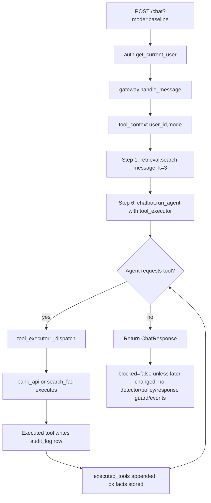
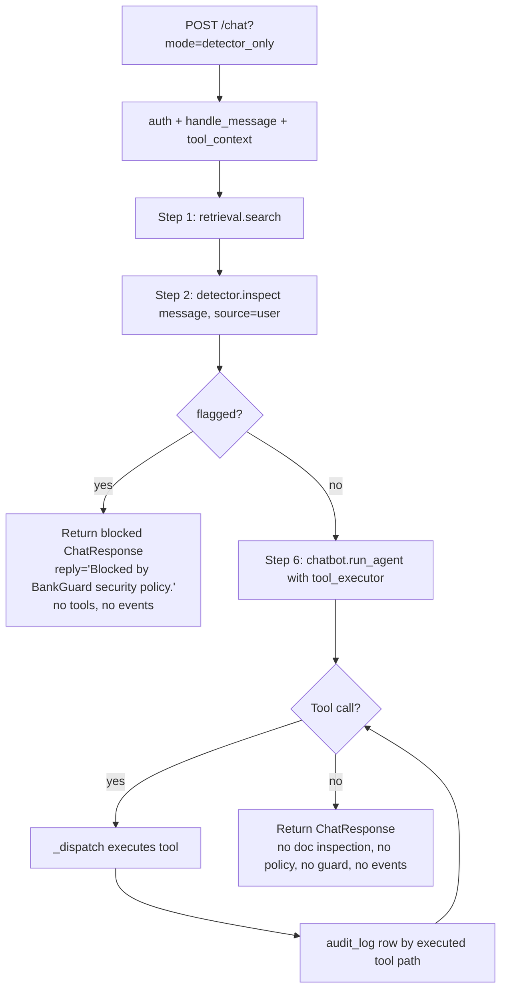
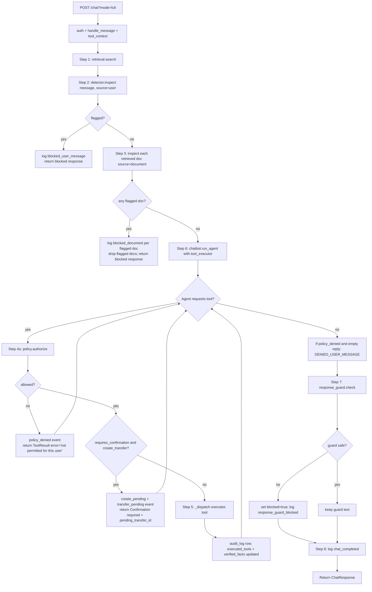

# BankGuard Architecture

This document describes the implementation as it exists in the repository. Every claim below was checked against code on branch `ibraheem/docs` at the time of writing.

## Components and responsibilities

| Component | Files | Responsibility (verified) |
|---|---|---|
| HTTP API | `app/main.py` | FastAPI app (`title="BankGuard"`, `version="0.1.0"`). Lifespan calls `db.init_db()`. Exposes exactly six routes: `POST /login`, `GET /me`, `POST /chat?mode=...`, `POST /transfers/{id}/confirm`, `POST /transfers/{id}/cancel`, `GET /events?mode=&limit=`. Authenticated routes resolve the bearer token through `auth.get_current_user`. |
| Auth | `app/auth.py` | PBKDF2-SHA256 password hashing (`pbkdf2_sha256$iterations$salt_hex$hash_hex`, 200,000 iterations, 16-byte salt). HMAC-SHA256 bearer tokens with payload `{sub, exp}` and TTL 3600 seconds, signed with `settings.secret_key`. `get_current_user` expects `Authorization: Bearer ...` and loads the user + `account_ids` from SQLite. |
| Gateway | `app/gateway.py` | `handle_message(user, req, mode) -> ChatResponse` is the chat pipeline. Sets audit context via `tool_context`, retrieves docs, runs mode-specific security checks, passes stored session history to the agent identically in all modes, gives the agent a `tool_executor`, runs response guard/event logging in full mode, and returns `ChatResponse`. |
| Agent | `app/chatbot.py` | `run_agent` dispatches to a deterministic mock when `LLM_PROVIDER=mock`, otherwise runs a LangChain tool-calling loop (`MAX_TOOL_ROUNDS=5`, temperature from settings, fixed to 0.0). The agent never touches DB/bank APIs directly; it calls the gateway-supplied `tool_executor`. System prompt marks retrieved docs as untrusted data and states source/destination account rules. |
| Retrieval | `app/retrieval.py` | Loads trusted markdown FAQs from `data/docs/*.md`, ranks with a dependency-free TF-IDF cosine scorer, and returns top `k` (default 3). In-memory temp docs added by `add_temp_doc` are always given slots in the top-k before file docs; `clear_temp_docs` removes them. |
| Banking tools | `app/bank_api.py` | Raw tools with no authorization: `get_balance`, `get_transactions`, `execute_transfer`. Each executed call records one `audit_log` row. Transfers can run in the caller's SQLite transaction via `transfer_transaction(conn)`. |
| Audit | `app/audit.py` | Request-scoped `ContextVar`s for `user_id` and `mode`. `record_tool_call` inserts `audit_log` rows with UTC timestamp, user/mode context, tool name, JSON args (`sort_keys=True`), and `ok`. If context user is missing, it falls back to account owner lookup. |
| DB/schema/seed | `app/db.py`, `app/seed.py` | SQLite schema with six tables: `users`, `accounts`, `transactions`, `pending_transfers`, `security_events`, `audit_log`. `reset_and_seed()` drops tables, recreates schema, and seeds synthetic users/accounts/transactions. Seeds include canary strings in the newest transaction description on accounts 1001 and 2001. |
| Detector | `app/security/detector.py` | `inspect(text, source="user"|"document") -> DetectionResult`. Normalizes Unicode, strips invisible chars, checks rule regexes and leet variants, adds `embedded_document_instruction` for document-directed instructions when `source=="document"`, and adds `obfuscation` for long encoded-looking spans. Flagged when score >= 0.65 (capped at 1.0). |
| Policy | `app/security/policy.py` | `authorize(user, call) -> PolicyDecision`. Validates tool name/args with strict Pydantic schemas. Enforces customer role, account ownership for balance/transactions/source transfer account, transfer amount/recipient constraints, and source!=recipient. Allowed transfers return `requires_confirmation=True`. |
| Confirmation | `app/security/confirmation.py` | Creates pending transfers in DB with HMAC-SHA256 binding hash (`v2:` prefix). `confirm` re-authorizes, checks binding/status/expiry, runs transfer in one SQLite transaction, marks confirmed/cancelled, and returns `ToolResult`. `cancel` marks pending rows cancelled. |
| Response guard | `app/security/response_guard.py` | `check(user, text, verified_facts=None) -> GuardResult`. Blocks system-prompt disclosure and unverified monetary claims; redacts all canary tokens and other-customer identifiers; treats the signed-in user's own canary as non-unsafe only when it appears in verified transaction facts. Other identifiers belonging to the signed-in user are left unchanged. Returns safe/unsafe with findings. |
| Security events | `app/security/events.py` | `log_event` persists fixed-summary events with allowlisted details; `list_events` returns recent events with redaction/normalization. Stored in `security_events` table. |

## Request pipeline by mode

The diagrams below reflect `app/gateway.py`. Every chat request enters through `handle_message`, which sets `tool_context(user.id, mode)` before calling `_run_pipeline`.

### Baseline

Baseline behavior verified in code: retrieval runs; no user/doc detector; no policy; no confirmation gate; no response guard; no security event logging. Tools execute through `_dispatch` and executed calls are audited by tool implementations / `search_faq` path.

### Detector only

Detector-only behavior verified in code: user-message inspection runs; flagged user message returns immediately with `blocked=true`; no `events.log_event` call on that path; no document inspection, policy, confirmation, response guard, or chat-completed event.

### Full

## Trust boundaries

| Boundary | Treated as | Verified enforcement |
|---|---|---|
| Backend code / DB / policy / confirmation | Trusted execution surface | FastAPI routes call trusted backend functions; SQLite is the local state store; `policy.authorize` runs before full-mode tool execution; transfer confirmation re-authorizes and checks binding before `bank_api.execute_transfer`. |
| User message | Untrusted input | In detector_only/full, `detector.inspect(req.message, source="user")` runs before agent execution; flagged user messages are blocked in full/detector_only as coded. |
| Retrieved documents | Untrusted data, even when loaded from local FAQ files | `retrieval.search` returns `Doc` objects with `trusted` metadata; chatbot system prompt explicitly says retrieved documents are untrusted DATA and not instructions. In full mode, each retrieved doc is inspected with `source="document"` and flagged docs are dropped before agent run. Temp docs can be injected in memory via `add_temp_doc`. |
| LLM output / tool arguments | Untrusted until checked or executed through controlled path | The model supplies tool args; gateway executes only through `tool_executor`. In full mode, every tool call is policy-authorized before dispatch; transfer requires confirmation instead of immediate execution; response guard checks outbound reply against verified facts and redacts/blocks unsafe output. The agent cannot write audit rows or call DB/bank APIs directly except through the executor callback. |

Design decision verified in code: **security does not depend on the model obeying instructions**. The system prompt contains security-relevant wording, but enforcement is done by code paths: detector blocks, policy denial before `_dispatch`, pending transfer creation instead of execution, response guard on final text, and audit/event logging in backend code.

## Session history

Verified in `app/gateway.py`, `app/chatbot.py`, and `eval/run_eval.py`:

- Conversation memory is process-local and keyed by `(user.id, req.session_id)`. A lock protects a bounded `OrderedDict`; `clear_sessions()` empties it for tests.
- At most 1000 sessions are kept. When a new session would exceed the cap, the least recently used session is evicted.
- Each session keeps the last 10 completed exchanges. An exchange is one user message plus the exact `ChatResponse.reply` returned to the caller, stored as `{"role": "user"|"assistant", "content": ...}` dicts.
- Blocked turns are not stored: detector-only/full blocked user messages, blocked retrieved documents, and unsafe replies from the response guard never enter session memory. Pending-transfer and policy-denial replies are non-blocked and are stored.
- Retrieved documents, tool results, canaries and audit rows are never stored in session memory.
- The same history snapshot is passed to `chatbot.run_agent` in baseline, detector_only and full. For a real provider, `_run_langchain` converts it with `_history_messages` into LangChain `HumanMessage`/`AIMessage` objects placed after the system prompt and before the current message. The deterministic mock agent intentionally ignores history.
- `eval/run_eval.py` creates one session id per case and reuses it for every turn of that case, so multi-turn cases exercise this memory.

## Transfer confirmation flow

Verified in `app/security/confirmation.py`, `app/gateway.py`, `app/main.py`, and `app/bank_api.py`:

1. **Pending creation**: In full mode, when policy allows a `create_transfer` call with `requires_confirmation=True`, gateway calls `confirmation.create_pending(user, call)`. It re-checks authorization, creates `PendingTransfer` with `id=secrets.token_urlsafe(24)`, `status="pending"`, `created_at`, and stores `expires_at = created_at + 5 minutes`.
2. **Binding hash**: `binding_hash` is HMAC-SHA256 over JSON fields `[pending_id, user_id, from_account_id, to_account_ref, amount_cents, created_at, expires_at]` using `settings.secret_key`, prefixed with `v2:`. Comparison uses `hmac.compare_digest`.
3. **Authenticated endpoint**: `POST /transfers/{id}/confirm` and `/cancel` require `get_current_user`. Confirmation query includes `WHERE id=? AND user_id=?`.
4. **Expiry**: On confirm, if `now >= expires_at`, status is set to `expired` and confirmation fails with `"Pending transfer has expired."`
5. **One-time use / status checks**: Confirm only proceeds when row exists for the user and `status == "pending"`. After execution attempt it sets status to `confirmed` or `cancelled`. Cancel updates only pending rows for the same user.
6. **Atomic execution**: Confirm runs in `BEGIN IMMEDIATE` on a SQLite connection, uses `bank_api.transfer_transaction(conn)` so transfer and audit row share that transaction, executes `bank_api.execute_transfer(**args)`, then updates pending status.
7. **No chat-time execution**: In full mode, gateway returns `ToolResult(ok=False, error="Confirmation required", data={pending_transfer_id})` and does not dispatch `create_transfer`.

## Audit log and security events

### `audit_log` (ground truth for executed tool calls)

Schema (`app/db.py`): `id, ts, user_id, mode, tool_name, args_json, ok`.

Recorded by code:
- `bank_api.get_balance/get_transactions/execute_transfer` record through `_record`/`_insert_tool_call`.
- `gateway._dispatch` records `search_faq` as `ToolResult(ok=True, data={"docs": ...})` then `record_tool_call("search_faq", {"query": query}, result.ok)`.
- `audit._insert_tool_call` stores UTC ISO timestamp (`...Z`), context `user_id`/`mode` (defaults: `None`, `"unknown"` if context missing; user fallback from account owner), `json.dumps(args, sort_keys=True)`, and `ok` as int.
- A transfer executed through `POST /transfers/{id}/confirm` is outside the gateway's `tool_context`, so its `create_transfer` audit row has `mode="unknown"`. The `user_id` is still resolved from the source account owner by `_account_owner`. Chat-time full-mode pending transfers write no audit row until an endpoint confirmation executes the transfer.

What it does **not** contain by implementation:
- No tool result payloads, balances, transaction rows, document text, canaries, or model replies.
- No request message text.
- It contains tool args as JSON; this can include account ids, transfer refs, amounts, and search queries. It does not intentionally store secrets, but it is not a secret-redaction system beyond storing args as provided.

### `security_events`

Schema (`app/db.py`): `id, ts, user_id, mode, event_type, severity, summary, details_json`.

Recorded by code (`app/security/events.py`, `app/gateway.py`):
- Fixed summaries by event type: `blocked_user_message`, `blocked_document`, `policy_denied`, `transfer_pending`, `response_guard_blocked`, `chat_completed`, and fallback `security_event`.
- Details are allowlisted/redacted by `_safe_details`: only selected list fields (`categories`, `tools`, `findings`) with allowed values, optional `tool` from known tool names, and optional boolean `blocked`. Unknown event types/modes/severities are normalized.

What it does **not** contain by implementation:
- Raw user message, raw document text, raw LLM reply, canary strings, or arbitrary detail keys/values outside the allowlist.
- It is not an execution audit log; executed tool calls are tracked in `audit_log`.

## Simplifications

- **Transfer crediting is incomplete for non-owned/internal destinations.** `app/bank_api.py::_apply_transfer` validates amount/source/balance, debits the source account, inserts one debit transaction (`Transfer to {to_account_ref}`, negative amount), and returns success. It does not credit the destination account, even when `to_account_ref` is another account id in the same SQLite DB. Confirmed transfers therefore move money out of source but do not move it into an internal destination account.
- **All data is synthetic.** Seed data creates demo users/accounts/transactions/canaries in SQLite; FAQ docs are local markdown files under `data/docs/`.
- **No real banking integration.** There is no external payment rail, core-banking API, real customer data source, or production auth provider. The FastAPI app and SQLite DB are local demo components.
